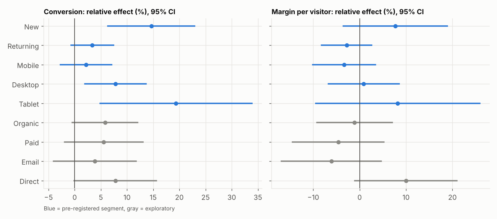
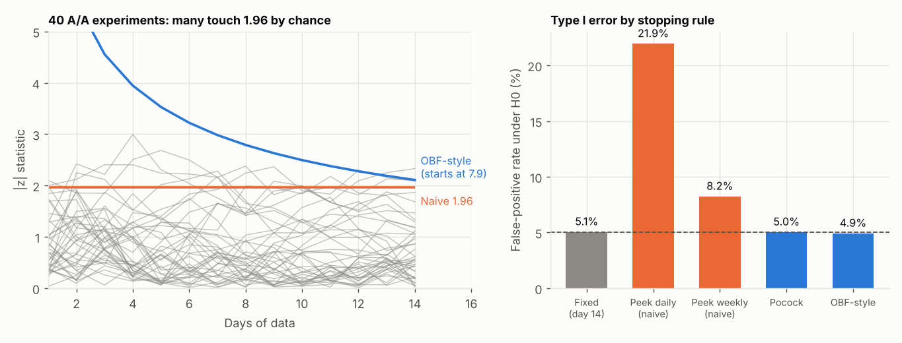
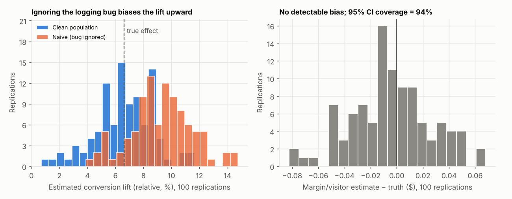

# Free-Shipping Threshold A/B Test

**Should a fashion e-commerce store lower its free-shipping threshold from $100 to $75?** A simulated experiment, analysed end to end, finishing with a ship / segment / keep decision.

> **Simulated data, built with Claude Code.** Because the data is simulated, the true effect is known, so every method below is checked against the right answer. No real-data result is claimed. A Criteo replication script is included (`src/05_criteo_replication.py`) but has not been run.

## The decision

| | |
|---|---|
| **Feature** | Free-shipping threshold at checkout: $100 → $75, for every order |
| **Decision** | Roll out to everyone, roll out to a segment, or keep $100 (VP Growth decides; Finance signs off on margin) |
| **Decision metric** | Margin per visitor = conversion × margin per order. Guardrail: return rate |
| **Decision rule** | Ship only if conversion is significantly up, the margin CI's lower bound is above −2%, and returns are not significantly up |

The feature gives away margin to buy conversion, so conversion alone would count a shipping subsidy as a win. Margin per visitor nets both sides.

## What I found

| | Result |
|---|---|
| Conversion | **+5.7%** (95% CI +2.1% to +9.4%) |
| Margin per visitor (decision metric) | **Inconclusive:** -0.7% (CI -5.5% to +4.2%), or −$586K to +$443K per year |
| Net shipping cost per order | +28% |
| Recommendation | **Do not ship to everyone.** Fix the logging bug, then test new customers, where the economics look best |

A 14-day test can only detect a 6.7% change in margin per visitor, so an inconclusive margin result was the expected outcome, and the design doc says so up front. The ground truth agrees: the true margin effect is +1.5% during the test and +0.1% at steady state, smaller than the test could resolve.



New customers look best, but the new-vs-returning interaction test is not significant (p = 0.10), so that is a hypothesis for the follow-up, not a finding.

## What is in the analysis

| Step | What it shows | Result |
|---|---|---|
| Design and power | Metric tree, decision rule, minimum detectable effect | 6.7% MDE on margin per visitor; the bootstrap power check gives 76% where the formula says 80% (heavy tails) |
| **Sample ratio mismatch** | An injected logging bug, found before looking at effects | χ² p = 3e-17; traced to old-app mobile users. Ignoring it gives a +8.7% conversion lift instead of +5.7% |
| Pipeline validation | 1,000 A/A tests on control-only users | False-positive rate 4.6% to 5.4% |
| Heavy-tailed outcome | Welch, winsorised and bootstrap estimates | Agree within noise |
| **Variance reduction** | CUPED and regression adjustment | Only 2.2% variance reduction: purchases are rare and 40% of users are new with no history |
| Multiple testing | Holm for the six non-primary metrics, BH for segments | Conversion survives correction; no margin segment does |
| **Peeking** | Daily looks vs corrected sequential boundaries | 21.9% false positives with daily looks vs 4.9% with O'Brien–Fleming-style boundaries (78% power vs 79% fixed) |
| **Ground-truth check** | 100 full replications of the experiment | 94% CI coverage on margin per visitor; the naive analysis covers the truth 69% of the time |





## Read this next

- [`memo/02_decision_memo.pdf`](memo/02_decision_memo.pdf): the recommendation, the decision-rule check, dollar impact and next steps
- [`memo/01_experiment_design.pdf`](memo/01_experiment_design.pdf): the product brief, metrics, power analysis and analysis plan
- [`notebooks/ab_test_walkthrough.ipynb`](notebooks/ab_test_walkthrough.ipynb): an executed walkthrough of the key results

## Reproduce

Tested on Python 3.13.

```
pip install -r requirements.txt
bash run_all.sh --skip-montecarlo     # about a minute
bash run_all.sh                       # adds the 100-replication run, about 10 minutes
```

Seeds are fixed, so the numbers reproduce exactly. The PDFs need `pandoc` and `wkhtmltopdf`; without them that step is skipped.

## How the data is built

`data_gen/generate_experiment.py` simulates both potential outcomes for every user, so the true effect is known. It includes zero-inflated heavy-tailed baskets with rare giant orders, pre-period spend, new-vs-returning differences, basket-padding toward the threshold, day-of-week seasonality, a novelty effect, returns, and an **injected exposure-logging bug** (treatment users on old mobile app versions go missing, mostly non-buyers). Cost model: 42% gross margin, $9.00 carrier cost, $7.50 customer fee under the threshold, $6 per return.

## Repository layout

```
data_gen/generate_experiment.py   simulator (both arms' outcomes, hidden truth)
src/abtools.py                    toolkit: SRM, SMD, Welch, bootstrap, CUPED, delta method, sequential boundaries
src/01_power.py ... 08_build_docs.py   one script per step of the analysis
notebooks/                        executed walkthrough
memo/                             design doc and decision memo (md + PDF)
figures/  results/                every chart and every number cited
run_all.sh                        reproduces everything
```

## Limitations

- Simulated users are independent: no interference, network effects or long-run behaviour change. A marketplace with shared inventory or delivery capacity would need cluster or switchback designs.
- The cost model and effect sizes are plausible assumptions, not estimates from a real business.
- Pre-period covariates are weak by construction; a real site with richer history would see larger CUPED gains.
- Sequential boundaries assume equal information per day; a production design would use alpha-spending on actual information fractions.
- The decision-rule thresholds (−2% margin tolerance, return-rate wording) are my choices; in a real project they would be agreed with Finance before the test.
