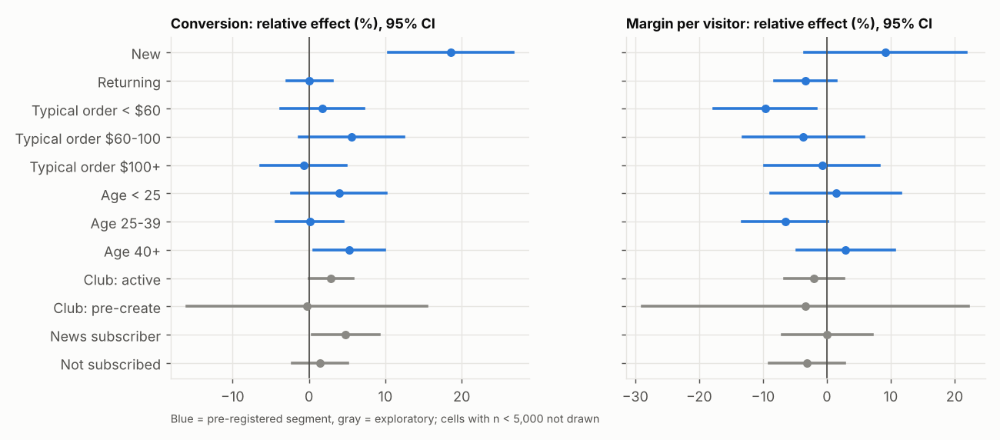
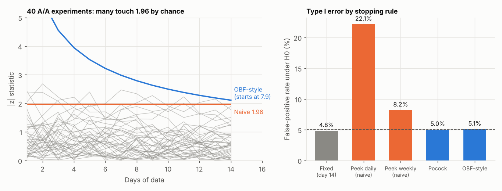
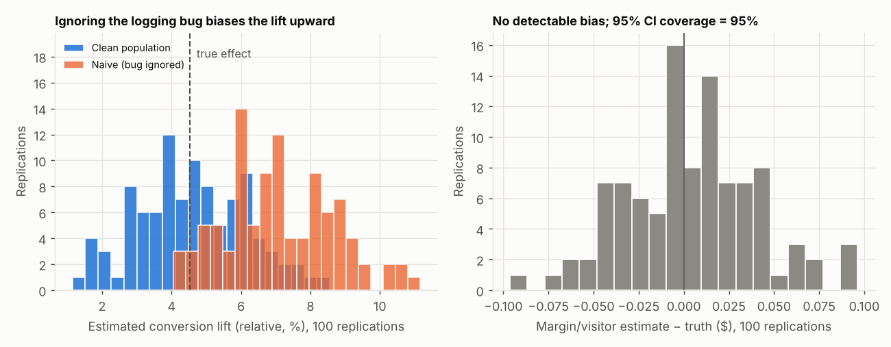

# Free-Shipping Threshold A/B Test

**Should a fashion e-commerce store lower its free-shipping threshold from $100 to $75?** A semi-synthetic experiment on **real H&M customers and orders**, analysed end to end, finishing with a ship / segment / keep decision.

> **Semi-synthetic, built with Claude Code.** The customers, their order history and what they actually bought in a 14-day window are **real** ([H&M Personalized Fashion Recommendations](https://www.kaggle.com/competitions/h-and-m-personalized-fashion-recommendations/data) on Kaggle). The **treatment effect, returns and the logging fault are simulated**, because no public dataset contains a shipping-threshold experiment. That choice has a purpose: the true effect is known, so every method below is checked against the right answer. No business result is claimed.

## The decision

| | |
|---|---|
| **Feature** | Free-shipping threshold at checkout: $100 → $75, for every order |
| **Decision** | Roll out to everyone, run a targeted follow-up in a segment, or keep $100 (VP Growth decides; Finance signs off on margin) |
| **Decision metric** | Margin per visitor = conversion × margin per order. Guardrail: return rate |
| **Decision rule** | Tier 1 (everyone): ship only if conversion is significantly up, the margin CI's lower bound is above −2%, and returns are not significantly up. Tier 2 (segments): a pre-registered segment earns a targeted follow-up if its conversion lift survives multiple-testing correction and a margin gain is not ruled out |

The feature gives away margin to buy conversion, so conversion alone would count a shipping subsidy as a win. Margin per visitor nets both sides.

## What I found

| | Result |
|---|---|
| Conversion, all customers | **+2.9%** (95% CI +0.1% to +5.7%); not significant after Holm correction (p = 0.21) |
| Margin per visitor (decision metric) | **Inconclusive:** -1.9% (CI -6.4% to +2.7%), or −$989K to +$416K per year |
| Net shipping cost per order | +27% |
| New customers (no online purchase in the prior 13 months) | Conversion **+18.6%** (survives correction); margin +9.1% (CI -3.5% to +21.8%) |
| Recommendation | **Keep $100 for the general customer base. Run a targeted follow-up test for new customers**, sized for the margin lift Finance requires |

A 14-day test can only detect a 5.5% change in margin per visitor, so an inconclusive overall margin result was the expected outcome, and the design doc says so up front. The ground truth agrees: the true overall margin effect is +0.3% during the test and -0.5% at steady state, smaller than the test could resolve, while new customers truly gain (+7.0% at steady state) and returning customers truly lose (-1.6%).



The pattern makes economic sense: customers with no history are the ones a lower threshold can win, while returning customers mostly stop paying a fee. But the formal new-vs-returning interaction test for margin is **not significant (p = 0.06)**, and no segment's **margin** effect is significant after correction. One cell looks significant before correction (Typical order < $60: margin -9.7%, raw p = 0.025) and does not survive Benjamini–Hochberg (p = 0.32). With 13 segment cells, about 0.7 raw p-values below 0.05 are expected by chance alone, so a single raw hit is weak evidence and segment margin results are hypotheses to validate, not findings. Club status and fashion-news cells are exploratory. The new-vs-returning margin interaction test is not significant (p = 0.06), so the new-customer result is a hypothesis for the follow-up, not a finding.

## What is in the analysis

| Step | What it shows | Result |
|---|---|---|
| Design and power | Metric tree, decision rule, minimum detectable effect | 5.5% MDE on margin per visitor; the bootstrap power check gives 89% where the formula says 93% (heavy tails) |
| **Sample ratio mismatch** | An injected logging fault, found before looking at effects | χ² p = 1e-12; traced to the old-app group. Ignoring it gives a +4.9% conversion lift instead of +2.9% |
| Pipeline validation | 1,000 A/A tests on control-only customers | False-positive rate 5.2% to 5.0% |
| Heavy-tailed outcome | Welch, winsorised and bootstrap estimates | Agree within noise |
| **Variance reduction** | CUPED and regression adjustment | Only 4.7% variance reduction: purchases are rare and 43% of customers are new with no history |
| Multiple testing | Holm for the six non-primary metrics, BH for segments | One segment margin cell looks significant before correction and does not survive it |
| **Peeking** | Daily looks vs corrected sequential boundaries | 22.1% false positives with daily looks vs 5.1% with O'Brien–Fleming-style boundaries (93% power vs 94% fixed) |
| **Ground-truth check** | 100 full replications of the experiment | 95% CI coverage on margin per visitor; the naive analysis covers the truth 59% of the time |





## Read this next

- [`memo/02_decision_memo.pdf`](memo/02_decision_memo.pdf): the recommendation, the decision-rule check, dollar impact and next steps
- [`memo/01_experiment_design.pdf`](memo/01_experiment_design.pdf): the product brief, metrics, power analysis and analysis plan
- [`notebooks/ab_test_walkthrough.ipynb`](notebooks/ab_test_walkthrough.ipynb): an executed walkthrough of the key results

## Reproduce

Tested on Python 3.13. The H&M files are not in this repository (Kaggle competition data, not mine to redistribute), so there is a one-time preparation step.

```
pip install -r requirements.txt

# 1. Download customers.csv and transactions_train.csv from the Kaggle competition page
#    (free account; accept the competition rules), then build the small per-customer tables (~1 minute):
unzip -p transactions_train.csv.zip | python data_gen/prepare_hm_base.py --customers customers.csv --out data/hm_base

# 2. Run everything
bash run_all.sh --skip-montecarlo     # about a minute
bash run_all.sh                       # adds the 100-replication run, about 10 minutes
```

Seeds are fixed, so the numbers reproduce exactly. The PDFs need `pandoc` and `wkhtmltopdf`; without them that step is skipped.

## How the data is built

`data_gen/prepare_hm_base.py` turns the raw H&M files into one row per customer: age, club-member status, fashion-news subscription, 90-day pre-period online spend and order count, whether the customer has ever bought online, and what they actually bought online in a 14-day window (basket value, items, day). An order is one customer's online purchases on one day (`sales_channel_id` = 2, the usual reading of the dataset).

`data_gen/generate_experiment.py` then samples customers, randomises them, and simulates the treatment on top of the real control outcome, generating both potential outcomes for every customer so the true effect is known:

| Real (H&M) | Simulated (assumptions) |
|---|---|
| Customers, age, club status, news subscription | Who responds: no-history customers most; among returning customers, those whose usual order is $60–$100; none among $100+. Age, club and news have no true effect, so they act as negative controls |
| Order history, pre-period spend, new vs returning | Extra buyers, basket padding up to $75, a novelty effect that decays over about 3 days |
| Who bought in the window, basket value, items, day | Returns, the cost model (42% margin, $9.00 carrier cost, $7.50 fee under the threshold, $6 per return) |
| Heavy-tailed real baskets and real daily traffic | An injected exposure-logging fault (about 9% of customers flagged old-app, treatment arm only, mostly non-buyers) |

The pilot sample used for planning is the real 14-day period before the test window, control experience only.

## Repository layout

```
data_gen/prepare_hm_base.py       stage 1: real H&M files -> small per-customer tables (run once)
data_gen/generate_experiment.py   stage 2: randomise, simulate the treatment, write the hidden truth
data_gen/legacy_fully_synthetic.py  version 1 generator (fully simulated), kept for reference
src/abtools.py                    toolkit: SRM, SMD, Welch, bootstrap, CUPED, delta method, sequential boundaries
src/01_power.py ... 08_build_docs.py   one script per step of the analysis
extras/                           optional Criteo replication script (not run, not part of the results)
notebooks/                        executed walkthrough
memo/                             design doc and decision memo (md + PDF)
figures/  results/                every chart and every number cited
run_all.sh                        reproduces everything
```

## Limitations

- **The treatment effect is an assumption.** The control data is real, but no real shipping-threshold experiment sits underneath it. The segment analysis therefore tests whether the methods separate responsive from null segments that I defined in the simulator; it does not discover who responds in the real world.
- H&M prices are anonymised, so order values are rescaled so the median order is $62 (the $75 and $100 thresholds land at fixed points of the real basket distribution). I assumed the store ran a $100 threshold during the window and that real baskets already contain any padding it caused.
- "Visitors" are all customers in the file, including people who did not buy in the window; true site traffic is not in the data. Postal codes are hashed, so there is no regional segment. "New" means no online purchase since the data starts (about 13 months), which mixes first-time and lapsed customers.
- Returns are not in the dataset and are simulated. Customers are independent: no interference, network effects or long-run behaviour change.
- The cost model and the decision-rule thresholds (−2% margin tolerance, return-rate wording) are my choices; in a real project they would be agreed with Finance before the test.
- Sequential boundaries assume equal information per day; a production design would use alpha-spending on actual information fractions.
