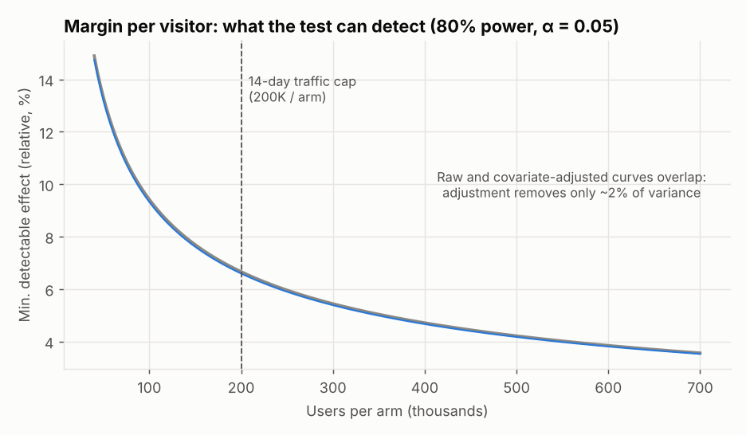

# Experiment Design: Free-Shipping Threshold $100 → $75

*Status: drafted before analysing the experiment (see the process note in section 1). Planning inputs come from a separate historical sample of 150,000 control-experience users. All data in this project is **simulated**.*

## 1. Product brief
| | |
|---|---|
| **Feature** | Free-shipping threshold at checkout: lower from $100 to $75, for every order on web and app |
| **Who decides** | Checkout / Growth PM proposes, VP Growth decides, Finance signs off on the margin definition |
| **User problem (assumed)** | Carts under the threshold see a $7.50 shipping fee late in checkout. Shoppers with a $75–$100 cart either leave or pad the cart to reach free shipping. |
| **Hypothesis** | Removing the fee for $75–$100 carts raises conversion enough to pay for the shipping cost we absorb on those orders |
| **Why it is not obvious** | Every order in the $75–$100 band becomes less profitable even if more people buy, so conversion alone would score the feature as a win |
| **Decision** | Roll out at $75 to everyone, roll out to a segment, or keep $100 |
| **Reversibility** | A threshold is a config change, so a wrong launch can be rolled back. The cost of being wrong is the margin given away until someone notices |
| **What the decision is worth (planning figure, all traffic)** | About 10.4M visitors a year × $1.06 margin per visitor ≈ $11.1M margin a year. 1% of margin per visitor ≈ $111K a year; the 6.7% MDE ≈ $739K a year |

**Metric tree**
```
Margin per visitor  =  conversion rate  ×  margin per order
margin per order    =  42% × basket × (1 − return)  −  net shipping cost  −  $6 × return
```

**Decision rule** (evaluated on the primary population after validity checks):

| Outcome | Condition | Action |
|---|---|---|
| **Ship to everyone** | Conversion significantly up (Holm p < 0.05) **and** margin per visitor 95% CI lower bound above −2% **and** return rate not significantly up | Roll out; keep a 5% holdout |
| **Do not ship broadly; targeted follow-up** | Anything else that is not a kill, i.e. margin is inconclusive | Test the pre-registered segment (new customers) or a cheaper variant |
| **Keep $100** | Margin CI upper bound below 0, **or** conversion not significantly up, **or** return rate significantly up | Stop |

The −2% is the margin loss Growth would tolerate in exchange for new-customer growth. In a real project I would agree it with Finance before the test.

*Process note: in this portfolio build, the first draft already contained the margin criterion (CI lower bound above −2%) and the rule "inconclusive margin means do not ship broadly". The Keep-$100 row, the return-rate wording and the table layout were added afterwards for clarity. The recommendation does not depend on them.*

## 2. Design
| Item | Choice | Why |
|---|---|---|
| Randomisation unit | User (assigned on first visit in the window) | Avoids one person seeing both prices |
| Allocation | 50 / 50 | Maximises power |
| Window | 14 days | Covers two full weekly cycles; business cap on run time |
| Traffic | about 28,571 users/day, 400,000 total, 200,000 per arm | Planning assumption |
| Exposure logging | Client-side tag | **Known risk:** tag failures would cause SRM, so SRM is checked first |

## 3. Metrics
| Role | Metric | Definition |
|---|---|---|
| **Primary** | Margin per visitor | 42% × merchandise value after returns − net shipping cost − $6 per return, summed per assigned user (zeros included) |
| Driver (secondary) | Conversion rate; net revenue per visitor | Did the feature do what it was built to do? |
| Mechanism (diagnostic) | AOV; items per order; net shipping cost per order | Explain *why* margin moved. Shipping cost rises by construction, so it cannot be a guardrail |
| Guardrail | Return rate per order | Extra buyers may return more. Page-load time is not simulated |
| Pre-registered segments | New vs returning; device | Chosen *before* data, because new customers are expected to respond most |
| Exploratory segments | Traffic source | Reported but flagged exploratory |

**Assumptions (cost model):** carrier cost $9.00 per order; customers under the threshold pay a $7.50 fee, so net shipping cost is $1.50 (paid) or $9.00 (free).

## 4. Baseline and variance (from the historical sample)
- Conversion: **3.24%**
- Margin per visitor: **$1.06**, standard deviation **$8.00** (coefficient of variation 7.5: zero-inflated and heavy-tailed)
- Outlier rule: winsorise per-user margin at the pilot 99.95th percentile (**$121.94**); report raw and winsorised results

## 5. Power and sample size (α = 0.05 two-sided, power 80%)
| Question | Answer |
|---|---|
| Users per arm needed for a **5%** relative lift in margin per visitor | **355,011** → about **25 days** at planned traffic |
| Users per arm available in 14 days | **200,000** |
| Min. detectable effect on margin per visitor in 14 days | **6.7%** relative (6.6% after covariate adjustment) |
| Min. detectable effect on conversion in 14 days | **4.9%** relative |
| Simulation check of power at the margin MDE | formula says 80%, bootstrap simulation says **76%** at a 6.7% effect (heavy tails make the formula optimistic) |



**Honest planning conclusion:** a 14-day test is well powered for conversion but **under-powered for margin per visitor**. We accept this because 14 days is the business cap, and we record it up front: if margin per visitor comes back inconclusive, that is the expected outcome, not a failure of the test.
Covariate adjustment helps little (2.1% variance reduction in the pilot) because a purchase is a rare event and 40% of users are new with no history.

## 6. Analysis plan (fixed in advance)
1. **Validity first:** SRM chi-square at α = 0.001; covariate balance (|SMD| > 0.1 flagged); 1,000-split A/A test of the pipeline.
2. **Primary:** difference in mean margin per visitor with 95% CI (Welch), cross-checked by bootstrap, winsorised, CUPED and regression-adjusted versions.
3. **Driver, mechanism and guardrail metrics:** Holm-adjusted p-values across the six non-primary metrics; ratio metrics by delta method (users are the randomisation unit).
4. **Segments:** pre-registered segments get a formal interaction test; all segment cells are BH-adjusted.
5. **Time effects:** week-1 vs week-2 comparison and a linear trend test on the treatment effect.
6. **Decision rule:** the decision table in section 1.
7. **Looks:** no early stopping. A sequential design is evaluated separately (see peeking analysis).
