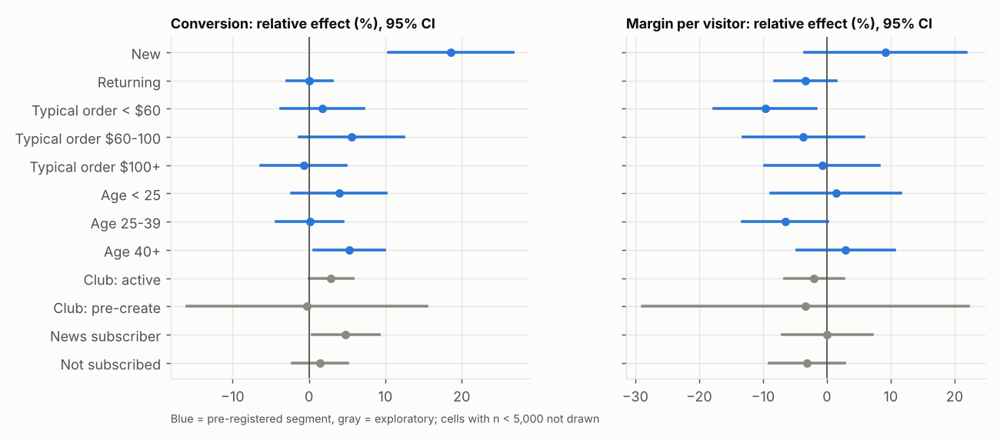

# Decision Memo: Free-Shipping Threshold $100 → $75

**To:** Product Lead, VP Growth  **From:** Data Science  **Data:** 14-day experiment on real H&M customers and orders with a **simulated** treatment effect, 394,780 customers logged

## The decision
| | |
|---|---|
| **Feature** | Free-shipping threshold at checkout: $100 → $75 |
| **Decision** | Roll out to everyone, roll out to a segment, or keep $100 (VP Growth decides, Finance signs off on margin) |
| **Decision metric** | Margin per visitor (conversion × margin per order). Guardrail: return rate |

## Recommendation
**Keep $100 for the general customer base, and run a targeted follow-up test for new customers.** Across all customers the $75 threshold raises shipping cost per order by 27% for certain, but conversion rises only +2.9% (95% CI +0.1% to +5.7%; p = 0.041 unadjusted, 0.21 after Holm correction) and **margin per visitor is not shown to hold**: -1.9% with a CI of -6.4% to +2.7%. The exception is **new customers** (no online purchase in the prior 13 months, 43% of customers): conversion is +18.6% there and survives multiple-testing correction, and the margin estimate is +9.1% (CI -3.5% to +21.8%), so a net-positive margin is plausible but unproven. Fix the exposure-logging bug first, then validate in that segment (below).

## What we found
| Metric | Control | Treatment | Effect (95% CI) | Adj. p |
|---|---|---|---|---|
| **Margin per visitor (primary)** | $1.63 | $1.60 | -1.9% (-6.4% to +2.7%) | p = 0.42 |
| Conversion rate | 5.27% | 5.42% | +2.9% (+0.1% to +5.7%) | 0.205 |
| Net revenue per visitor | $4.44 | $4.52 | +1.9% (-2.4% to +6.2%) | 0.77 |
| *Mechanism:* AOV | $95.10 | $94.92 | -0.2% (-3.1% to +2.7%) | 0.89 |
| *Mechanism:* net shipping cost per order | $3.81 | $4.86 | +27.4% (+24.4% to +30.4%) | <0.001 |
| *Guardrail:* return rate per order | 11.7% | 12.4% | +5.4% (-2.6% to +13.4%) | 0.53 |

*Analysis population: 363,848 users (see data-quality note). Adjusted p = Holm across the six non-primary metrics.*

## Decision rule check (rule in the design doc, section 1)
| Criterion | Result | Met? |
|---|---|---|
| Conversion significantly up (Holm) | +2.9%, p = 0.205 | **No** |
| Margin per visitor CI lower bound above −2% | lower bound -6.4% | **No** |
| Return rate not significantly up | +5.4%, p = 0.53 | Yes |
| Keep-$100 trigger (margin CI upper bound below 0, conversion not up, or returns up) | margin upper bound +2.7% | Triggered |

**Outcome (all customers):** conversion does not survive the Holm correction and margin is inconclusive, so the rule says **keep $100 for everyone**. **Segment tier:** only new customers qualify for a targeted follow-up (conversion lift significant after BH correction and a margin gain not ruled out).

**Dollar impact (assumes the analysed population stays at about 9.5M users/year; old-app users excluded):** margin per visitor changes by −$0.030 (CI −$0.104 to +$0.044), i.e. **−$286K per year, with a range from −$989K to +$416K**. The interval straddles zero, so the honest reading is "unknown sign, plausible range from −$989K to +$416K".

## Why I do not trust the topline conversion number without a fix
- **Sample ratio mismatch:** the treatment arm has 195,157 users vs 199,623 in control (χ² p = 1e-12). The shortfall sits entirely in users flagged as on an old app version (41.4% of that group landed in treatment vs 50% expected), where treatment exposure logging failed mostly for people who did **not** buy. This fault is injected (simulated) on purpose, to test that the pipeline catches it.
- If ignored, conversion lift reads +4.9% instead of +2.9%: the bug **overstates the win by about 2 points**.
- I excluded old-app users from both arms (a pre-treatment definition, so randomisation is preserved). Results therefore describe users who are not on the old app (about 92% of logged users).
- After exclusion the ratio is clean (p = 0.16) and covariates are balanced (all |SMD| < 0.01).

## Segments (treat as hypotheses, not findings)
| Segment (pre-registered) | Conversion | Margin per visitor | Conversion p (BH) |
|---|---|---|---|
| New | +18.6% (+10.4% to +26.7%) | +9.1% (-3.5% to +21.8%) | <0.001 |
| Returning | +0.1% (-2.9% to +3.0%) | -3.4% (-8.2% to +1.4%) | 0.972 |
| Typical order < $60 | +1.7% (-3.7% to +7.2%) | -9.7% (-17.7% to -1.7%) | 0.831 |
| Typical order $60-100 | +5.6% (-1.2% to +12.4%) | -3.7% (-13.2% to +5.8%) | 0.257 |
| Typical order $100+ | -0.7% (-6.3% to +4.9%) | -0.8% (-9.7% to +8.1%) | 0.972 |
| Age < 25 | +3.9% (-2.2% to +10.1%) | +1.4% (-8.7% to +11.6%) | 0.439 |
| Age 25-39 | +0.1% (-4.3% to +4.5%) | -6.5% (-13.2% to +0.2%) | 0.972 |
| Age 40+ | +5.3% (+0.7% to +9.9%) | +2.9% (-4.7% to +10.6%) | 0.119 |

The pattern makes economic sense: customers with no history are the ones a lower threshold can win, while returning customers mostly stop paying a fee. But the formal new-vs-returning interaction test for margin is **not significant (p = 0.06)**, and no segment's **margin** effect is significant after correction. One cell looks significant before correction (Typical order < $60: margin -9.7%, raw p = 0.025) and does not survive Benjamini–Hochberg (p = 0.32). With 13 segment cells, about 0.7 raw p-values below 0.05 are expected by chance alone, so a single raw hit is weak evidence and segment margin results are hypotheses to validate, not findings. Club status and fashion-news cells are exploratory.

## Other checks
- **Novelty:** week-1 conversion lift +2.5% vs week-2 +3.3%; difference p = 0.77 and trend test p = 0.95. At this volume a decay is not detectable either way, so week-2 numbers carry the same uncertainty as the full window. Week-2 margin is -1.6% (-8.2% to +5.0%).
- **Estimator robustness:** raw, winsorised, bootstrap, CUPED and regression-adjusted margin estimates agree within noise; CUPED shrinks variance by only 4.7%.
- **Peeking:** the daily p-value for conversion first dips under 0.05 on day 9. Stopping at the first significant look would have inflated false positives to 22%; we ran the full 14 days.

## Risks if we shipped anyway
1. Margin could be anywhere from -6.4% to +2.7%, i.e. −$989K to +$416K per year on the analysed population.
2. Shipping cost per order rises 27% for certain, and returns data is too sparse to rule out a rise.
3. Part of the conversion lift is likely novelty; we cannot size it from this test.
4. Results exclude old-app users, so they need a separate decision.
5. **Launch-and-watch is not a safe fallback.** The threshold is easy to reverse, but without a holdout the same noise applies and a before/after comparison is confounded by seasonality, so a margin loss of this size could go unnoticed.

## Proposed next steps
1. **Fix exposure logging** for old-app users and re-validate SRM before any new test.
2. **Follow-up test on new customers only** (the one segment that passed the segment tier). To detect a 5% margin lift needs about 672,704 users per arm (about 108 days at current new-customer traffic), which is impractical; a **10% MDE needs about 168,176 per arm (about 27 days)**. The +9% estimate comes from the best-looking segment, so expect it to shrink in the follow-up (winner's curse). Agree with Finance first on the margin lift that would justify launching, because that sets the sample size.
3. **Cheaper variants** to test in parallel: a $85 threshold, or a first-order-only free-shipping offer, which keep more of the margin.
4. Add a **long-run holdout** (5%) after any launch to measure the post-novelty effect.
